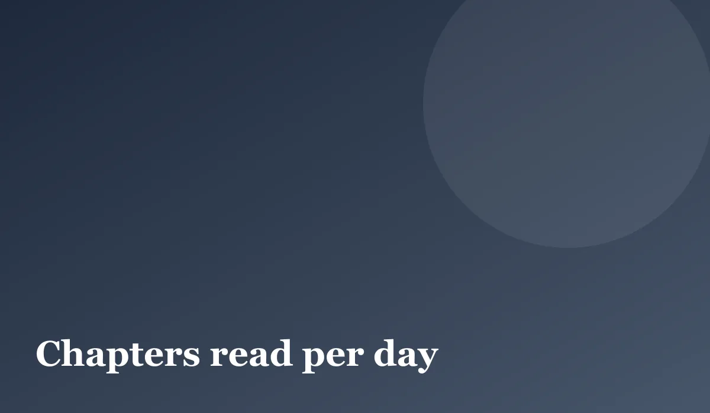

Serial fiction has quietly become one of the most-read formats on the web. Over the past twelve months, readers on News and Tales opened more chapters, stayed longer on each page and — most surprisingly — finished more stories from start to end than in any previous year.

The biggest driver is simple: chapters are short enough to read on a phone in a few minutes, and every chapter ends with a reason to keep going.

Readers told us they prefer stories that can be finished in a single evening. A twenty-chapter story with chapters of around 1,300 words takes about ninety minutes to read, which fits neatly between dinner and bedtime.

## Mobile Readers Now Make Up The Vast Majority

More than four out of five chapters were opened on a phone. Most reading happens in two windows: the morning commute and late evening.

That pattern shaped how we design every page: large text, generous line spacing and a table of contents that is always one tap away.

| Metric | 2025 | 2026 |
|---|---|---|
| Average chapters per visit | 3.1 | 4.6 |
| Stories finished | 38% | 52% |
| Reading on mobile | 74% | 83% |
| Average minutes per chapter | 4.2 | 4.8 |

## Cliffhangers Still Work Best

Chapters that end on an unanswered question are clicked through to the next chapter almost twice as often as chapters that end on a quiet moment. Readers want to know what happens next — and they want to find out immediately.

## What Comes Next

In the coming months we will publish more completed stories, add new genres and keep every story free to read. Thank you for reading with us.
